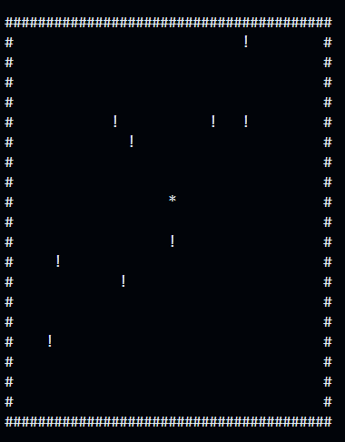

# Gluon-Browser
A simple, lightweight, fast, and secure browser that runs from the command line! 
Demo link (No Images): https://codehs.com/sandbox/yellowotter2314/browser/run

# About/Features
It is a web browser that runs fast and can be used to browse the web efficiently. It has many useful features such as tabs, saving pages for offline viewing, and even a built-in game if you want something to spend time on!

# Game
This browser includes a fun built-in game where you must move to avoid incoming walls, which is quite fun to play. It was based on one of my first games.

# How to Use
To run the software you have 3 options:  
First option, in-browser demo (images do not work):   
1. Go to link https://codehs.com/sandbox/yellowotter2314/browser/run  
2. Click run and wait for it to load  
Second option, download executable:  
1. Download the ZIP file in the release section  
2. There should be 2 files, one is the SkiaSharp library (.dll), and the other is the runnable file (.exe)  
3. Run the the .exe file  
Third option, compile from source:  
1. On the github page, click the green button that says "<> Code"  
2. Download ZIP  
3. Compile the code yourself  

Once running:  
Simply type a full URL (e.g. https://simple.wikipedia.org/wiki/computer), press Enter, and the webpage will load, ready to read!
You should also use the commands to improve your experience and use all of the features available! (Type "help" while running the program for a list of commands).

# Attribution
This is licensed under the MIT License, 2026 by Clippy-CLI

This software uses SkiaSharp, which is licensed under the MIT License.
Much of this project was developed for the Hack Club (https://hackclub.com/) Stardance event (https://stardance.hackclub.com/)
